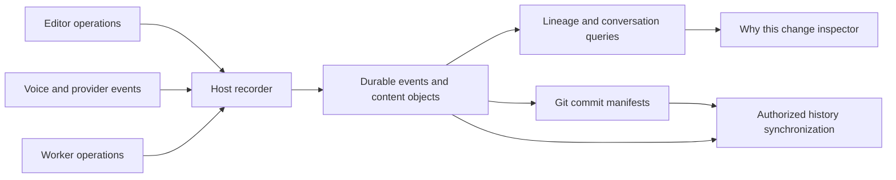

# Conversation and code history implementation plan

Status: planned, not implemented. Updated 2026-10-11. This is the implementation and verification plan for repository-level provenance in Zen: connecting human requests, voice guidance, agent invocations, decisions, edits and Git history. Commands, modules and tests described as proposed below do not exist yet.

The first usable release must answer “who changed this, at whose request, using which agent, and with what recorded explanation?” across the full assistance slider. The same records must remain meaningful when another developer fetches the work, a worker runs separately, or a change is reverted.

The user has reprioritized shared provenance and its eventual collaboration layer for this project. This does not reactivate issue boards, delivery pipelines, or dedicated SRE agents. Existing explicit acceptance, voice-only behavior, privacy controls and stale-buffer protection remain requirements.

## Product contract

1. Git remains the interoperable code history. Zen records the work between commits and maps it to the exact content committed.
2. Attribute mutations where they happen. Do not assign a diff to whichever conversation or agent was most recently active.
3. Separate the writer, requester, agent operator, acceptor and integrator. Human typing during AI coaching is human-authored code.
4. Separate observed execution from stated rationale, inferred influence and missing evidence. A model explanation is not proof of its internal causation.
5. Assistance zero forbids AI code proposals and application. At 100 the AI may generate the requested implementation, including workers, but existing human acceptance still applies. Automatic acceptance would require a separate product decision.
6. Record proposed, accepted, applied-to-buffer, saved and committed states separately. None implies tests passed. Test evidence names the exact code revision tested.
7. Reversals add events; they do not delete conversations or rewrite attribution. Private data erasure is a separate operation with explicit retention semantics.
8. No capture feature may interrupt speech on typing, navigation or slider changes, retarget an edit, or turn historical instructions into current authorization.
9. Unknown origins and coverage gaps remain visible. “Complete” means complete for a declared capture scope and supported operation set, not everything a user or model has ever done.
10. No remote service, account or model call is necessary to use local history. Sharing is an explicit project policy and authenticated operation.

## Current code and integration points

The baseline inspected for this plan is commit `251a4dd`.

| Existing component                             | Current behavior                                                                                   | Required integration                                                                                        |
| ---------------------------------------------- | -------------------------------------------------------------------------------------------------- | ----------------------------------------------------------------------------------------------------------- |
| `extension/src/core.ts`                        | Conversation entries and single-file proposals have no durable provenance identities               | Add host-owned references without making the model mint identities or expanding every model prompt          |
| `request-target.ts`                            | Captures editor context from transcript timing; resets with session                                | Preserve the captured snapshot and capture quality; link utterance revisions to the actual delegation input |
| `extension.ts`                                 | Receives transcripts, dispatches backend tasks, observes document changes, accepts native previews | Record conversation and mutation lifecycle at those boundaries                                              |
| `live-protocol.ts`, `extension/media/panel.js` | Client command acknowledgments, session timelines, transcript events and playback activity         | Distinguish sent, acknowledged, generated and playback-observed events                                      |
| `backend.ts`                                   | Builds actual provider messages; handles tool rounds, recovery, routing and formatting             | Capture each sanitized wire request/response separately, including retries and omitted context              |
| `agent-runs.ts`                                | Run IDs and launch-time definitions; bounded session-local activity                                | Persist run graph, exact delegation, result-delivery links and worker evidence                              |
| `task-workspace.ts`, `automation.ts`           | Isolated worker checkout, baseline snapshots and accepted multi-file change sets                   | Record worker edits and parent integration as distinct transactions                                         |
| `trace.ts`                                     | Optional diagnostic journal with truncation and reasoning redaction                                | Keep as diagnostics; do not make it the authoritative history store                                         |
| `assistance.ts`                                | Bands at zero, 1–25, 26–50, 51–75 and 76–100; every preview needs acceptance                       | Preserve policy and test every band boundary                                                                |
| Shared index service                           | One local daemon, authentication and scoped retrieval patterns                                     | Reuse architectural lessons, not the index database or wipe/migration lifecycle                             |

Native document-change callbacks do not universally identify keyboard input versus extensions or formatters. A supported native command/origin bridge is required before labeling those events as confirmed human typing. Until then, use `editor_unknown`. The same limitation applies to filesystem watchers and external processes.

## Architecture and storage

Add a host-owned history service with a pure event/reducer core, an authenticated local IPC boundary, editor/provider adapters, Git reconciliation and optional replication. Use the existing new Turso engine for a separate history database. Do not introduce libSQL, reuse the embedding database, or assume Turso database replication implements our causal sync protocol.



Proposed layout:

```text
repository/.zen/project.json             versioned discovery metadata only
~/.zen/history/v1/history.db             authoritative local events and indexes
~/.zen/history/v1/objects/               scoped encrypted content objects
~/.zen/history/v1/outbox/                durable publication work
OS credential store                     device keys and local encryption keys
```

Treat these as a storage contract to implement, not paths that currently exist. Local database metadata is sensitive too; encrypt content-bearing fields and avoid plaintext paths/messages in generic logs. Gate storage on verified ownership/permissions and secure key availability. Backups must include the database, required objects and a supported key recovery method. Do not silently fall back to plaintext when key access fails.

Objects hold snapshots, patches, provider input/output and messages. Deduplicate within an authorized repository/privacy scope. Do not create a cross-project hash lookup that leaks whether someone else has matching private content. Hash canonical plaintext internally, encrypt at rest, and verify object bytes on import. Shared, redacted exports have their own content identities; do not advertise them as byte-identical originals.

Enforce workspace trust, capture consent, context-sharing controls, ignore/private-path rules and realpath validation on ingestion, inspection, model retrieval and export. A file tracked by Git is not automatically safe to record. Revocation stops new capture/access governed by that permission without rewriting existing evidence into a false complete history. Historical bodies use their own retention/access policy; private source content must not leak through derived summaries, file names or search indexes. Do not capture unrelated desktop activity or clipboard contents.

Separate append-only event records from rebuildable query projections. A database index rebuild, embedding reindex, task worktree cleanup or personal-memory reset must never delete history. Append-only does not prohibit deliberate privacy erasure: content bodies can be purged with tombstones, and views report redacted/unavailable evidence. Do not imply that deleting locally removes copies already exported to another person.

### Repository initialization and identities

Implement editor commands first, backed by a library also usable by a proposed CLI:

| Proposed command                    | Behavior                                                                                   |
| ----------------------------------- | ------------------------------------------------------------------------------------------ |
| `zen init`                          | Initialize recording for a Git root; create or adopt its stable repository ID and baseline |
| `zen history status`                | Report capture scope, durable frontier, gaps, identity and sync status                     |
| `zen history why <path> --line <n>` | Query lineage at a particular worktree/version                                             |
| `zen history diff --request <id>`   | Show the surviving effects of a request across files and workers                           |
| `zen history publish` / `fetch`     | Exchange authorized manifests and content; do not silently push code                       |
| `zen history export` / `import`     | Portable, scoped bundles for offline collaboration and recovery                            |
| `zen history revert --request <id>` | Prepare a reviewable inverse; never silently apply or commit                               |

`project.json` includes `schemaVersion`, random `repositoryId`, optional `parentRepositoryId` for intentional forks, and an optional history-remote descriptor. It contains no credentials, executable configuration or private conversation. Initialization is idempotent, supports an unborn Git repository, does not auto-commit the configuration, and does not change remotes or Git hooks without an explicit setup action. Existing implementer support can remain limited to committed HEAD until extended separately.

Clones of one repository adopt its ID. Local worktrees and independent clones get separate checkout IDs. Renaming a remote or moving a folder does not change repository identity. Intentional forks receive a new repository ID and an explicit parent relationship; do not infer identity from a URL or file contents. Detect accidentally copied initialization files and conflicting initialization records instead of silently merging histories.

A tracked remote descriptor is a discovery hint, not permission to upload or to trust its server. First connection verifies the endpoint and project membership. Local actors begin with device-key identities; account linking appends a verified association and does not retroactively rewrite local authors. Git author names/emails are displayed as Git claims, not used as authenticated Zen identities.

### Event and relation model

Proposed envelope:

```ts
type HistoryEvent = {
  schemaVersion: 1;
  eventId: string;
  repositoryId: string;
  workspaceId: string;
  checkoutId: string;
  actorId: string;
  replicaId: string;
  sequence: number;
  causalParents: string[];
  occurredAt: string; // Display only; never establishes causal order.
  kind: string;
  payloadRef: string;
  policyRevision: string;
  signature?: string; // Required for authenticated remote publication.
};
```

Give separate stable IDs to sessions, utterances/messages and revisions, requests, task revisions, runs, provider invocations, tool calls, proposals, edit transactions, documents and integrations. Do not reuse a transport event ID outside its provider session. Host code propagates IDs through asynchronous work; an old background run cannot adopt the current request ID.

Each replica has a durable monotonic sequence and explicit parent references. Handle duplicates, missing dependencies and conflicting reuse of an ID. Use canonical versioned serialization for hashes/signatures. Remote ingestion validates actor membership, payload limits, schema versions, sequence consistency and object integrity. A signature authenticates the submitted record, not the truth of its explanation or the integrity of a compromised client.

Suggested tables/projections:

| Table                                                  | Purpose                                                       |
| ------------------------------------------------------ | ------------------------------------------------------------- |
| `repositories`, `checkouts`, `actors`, `replicas`      | Identities, local locations and verified associations         |
| `events`, `event_edges`, `objects`                     | Immutable records, typed relationships and content references |
| `messages`, `invocations`, `runs`                      | Inspectable conversation/provider/worker views                |
| `documents`, `versions`, `operations`, `range_origins` | Content reconstruction and attribution                        |
| `proposals`, `applications`, `integrations`            | Intent versus actual effects and acceptance                   |
| `commit_manifests`, `commit_ranges`, `rewrite_links`   | Many-to-many Git mapping                                      |
| `coverage_gaps`, `sync_outbox`, `remote_frontiers`     | Reliability and replication state                             |

Typed relationships include `requested_by`, `produced_by`, `accepted_by`, `integrated_from`, `observed_in_context`, `cites`, `declared_influence`, `inferred_influence`, `supersedes`, `reverts`, and `included_in_commit`. A message present in model context is observable; the model's claim that it motivated an edit is a different relationship. Store the provenance of every relationship, not just its endpoints.

Do not give a whole request one permanent `reverted` boolean. Active effects are computed for a selected workspace/version, and can be partial. One request may contain rejected proposals, accepted changes, later modifications and reverted changes simultaneously.

### Capture completeness and failure behavior

For instrumented AI applications, persist a prepared transaction with before versions, intended operations and provenance before applying. After applying, verify observed after versions and persist the outcome. Deduplicate native acceptance callbacks and document-change notifications using the application identity, not a time window.

The editor, database and filesystem cannot form one ordinary atomic transaction. On recovery, reconcile prepared operations against captured buffer/disk versions: applied, not applied, partially applied, or uncertain. An uncertain prepared operation must never be replayed automatically. A saved file and a previously accepted unsaved buffer are different recovery evidence.

Human typing must remain responsive. Queue immutable buffer operations and flush in short batches, recording an acknowledged durability frontier. If storage fails, allow human editing and visibly mark capture degraded; prevent a new AI mutation from claiming recorded provenance without its prepared record. Do not block speech playback or microphone transport. Bound the queue; overflow produces a gap, never silent truncation presented as complete history.

A crash can lose unacknowledged human buffer operations. Mark the crashed session's tail as uncertain and reconcile available restored buffers/disk. Do not promise zero-loss recovery for unflushed keystrokes. Large or binary files, symlinks, submodules and unsupported encodings initially receive explicit coverage boundaries; do not silently treat them as fully tracked text.

## Capturing all assistance styles

### Human typing with voice guidance

Record each finalized or revised user utterance and each assistant output segment, preserving provider session IDs and timestamps. Attach captured editor versions and the actual transcript revision supplied to delegation. The current transcript-arrival heuristic must remain labeled; precise audio-time targeting cannot be inferred from it.

Keep a separate coaching episode with the guidance, target range and expected action. Human edits can be associated as candidates when their target and result match, but temporal proximity or a code match alone does not establish influence. An explicit “I made that change,” user confirmation in the inspector, or another direct user statement can add a declared association. This should not create a confirmation prompt for every line. The automatic view may say “typed by you during this guidance,” never “written by the AI.”

Record `writer=human` only with a supported native input origin. An unclassified editor mutation remains `editor_unknown`. Preserve paste, completion acceptance, formatter, refactor, undo and remote-input origins distinctly. In guidance-only mode, copying a spoken line is still human application; the guidance relationship is separate from execution origin.

Audio output transcript, append acknowledgment and playback meter are different signals. Store generated text and playback state separately; do not claim exact words heard from an amplitude meter. Interrupted or unaligned playback is `partial_or_unknown`. Raw microphone audio is off by default. Synthetic audio may be retained in test fixtures; optional real recordings require explicit recording scope and retention.

### AI proposals and mixed work

Carry the initiating request/task revision and producing invocation through single-file previews, automatic completion candidates and native accept commands. Capture the actual selected replacement range and document version. Previewing or rejecting creates no applied-code authorship. Accepted fragments get their own applications; partial acceptance must be explicitly implemented, not inferred from the current all-or-nothing multi-file UI.

Record subsequent human edits as new operations. A line containing agent-written and human-written spans has mixed attribution. Formatters preserve prior origins for unchanged spans and add transformation evidence for the ranges they rewrite; do not claim perfect token-level lineage when a tool replaces a whole file without a reliable mapping.

At each request, snapshot the assistance policy and record subsequent policy revisions. Changing the slider does not interrupt speech or reattribute work. Application still checks current permissions and assistance rules. A pending implementation cannot be applied after assistance is set to zero.

### Provider and subagent records

Capture the actual allowlisted model request body after history trimming, prompt assembly, tool filtering and effort mapping, and before network dispatch. Never persist authorization headers or API keys. Record sanitized response bodies, returned provider IDs, error/finish state and usage when available. Distinguish a dispatched request with unknown outcome from one never sent.

Each retry, recovery call, effort-routing call, tool round, short-answer path and final formatting call is a separate invocation under the same run. Capture requested effort, mapped wire parameters, prompt-only effort guidance and provider-reported values separately. Unknown actual compute effort is not inferred from a slider. Model aliases may not reveal a fixed weight revision; record the requested ID and returned revision if provided.

Keep an exact input manifest with ordered message revisions, source snapshots, tool schemas/results, instructions, memory references and redaction/omission markers. Preserve actual permitted content, not just hashes, if later inspection is promised. A retained sanitized body must be labeled sanitized; hashes cannot recover redacted data. Provider-side hidden context and unrecorded raw audio remain outside capture coverage.

Reasoning has a capability descriptor per adapter: unavailable, opaque continuation state, provider summary, or provider-exposed text. OpenAI documents summaries rather than raw reasoning. Existing Zen discards Cerebras reasoning and keeps Together continuation fields ephemeral. Changing that retention is a deliberate privacy/API-adapter change in the provider milestone, not permission to remove trace redaction. Opaque continuation payloads are not readable explanations and are never forwarded into speaker output. [OpenAI reasoning documentation](https://developers.openai.com/api/docs/guides/reasoning).

Add concise decision records for consequential changes: statement, supporting message/evidence IDs, affected edit IDs, author and creation time. Store whether created during the work or retrospectively. Validate referenced IDs against the run's actual context. Model-selected relationships are declared explanations, not independently proved causes. Missing rationale must not be filled with invented reasoning.

Workers preserve their exact delegated prompt, launch-time profile, tools, context actually supplied, invocations, operations and report. Research output reaching the parent creates a result-delivery/context relationship, not worker code authorship. Integration of worker changes into the human checkout creates a new application linked to the original worker operations and acceptance actor. Preserve parent modifications and conflict resolution. Never attribute the human's pre-existing dirty files copied into a worker baseline to that worker.

## Document history and blame

Use a stable document ID separate from its path. Record path changes and before/after content hashes. Historical positions are `(documentId, versionId, range)`; current positions resolve through operations and retain mixed origins. Deleted ranges remain queryable at their historical version.

Milestone 0 must compare an operation/interval lineage implementation with a Yjs-backed document adapter for persistence, provenance, Unicode, deletion history and size. Yjs relative positions and idempotent updates are useful primitives; neither proves authorship or supplies Git integration. Persist deletion/operation history needed for historical queries even if an editing engine compacts live state. Avoid making a custom CRDT a prerequisite. [Relative positions](https://docs.yjs.dev/api/relative-positions), [document updates](https://docs.yjs.dev/api/document-updates).

The adapter contract must expose `applyObservedOperation`, `resolveHistoricalRange`, `originsForRange`, `materializeVersion`, and `planInverse`, with explicit unsupported/ambiguous results. If local lineage ships before multiplayer, preserve enough operations and original IDs to bridge into the shared engine at a checkpoint without rewriting historical provenance.

An instrumented move/rename can preserve exact identity. A similarity match after an external rewrite is inferred. A copied function, repeated line or later reinsertion of identical bytes is not automatically the same historical text. Make UTF-16 editor offsets, UTF-8 object bytes, Unicode graphemes and Git line endings explicit at adapter boundaries. Version hashes cover exact bytes/encoding policy, not an accidentally normalized approximation.

## Git coexistence and publication

At each observed commit, compare the real Git tree with its parent trees and map committed ranges to recorded versions/operations. Do not use “all requests since the last commit.” Include paths, modes, object format, blob/tree IDs, parent-relative changes, coverage and the contributing history references in a versioned manifest.

Partial staging is essential: the index can contain an earlier buffer version. Locate that version through retained snapshots/lineage; leave unrecorded staged edits unknown. A change may be split across commits, and a commit may contain many conversations. For merges, retain the selected parent comparison and integration event; do not credit the merge author with every inherited line.

Observe commits and rewrites through Zen's command integration, optional cooperative hooks and background reconciliation on startup/focus/ref changes. Preserve existing hooks; do not overwrite `core.hooksPath`. Hooks can be bypassed or unavailable and are not the sole source of truth. `post-rewrite` can help map amend/rebase, but external operations still require reconciliation. [Git hooks](https://git-scm.com/docs/githooks).

Keep Zen event IDs stable through amend, rebase, squash and cherry-pick. Record explicit old/new commit mappings when observed, and validate the resulting content. Patch similarity only proposes a candidate mapping; require evidence or label it inferred. Branch checkout/reset/stash are state transitions, not proof that historical work was deleted or intentionally reverted.

Optionally publish a manifest reference through `refs/notes/zen-history`. Notes do not alter commit IDs, but custom refs need explicit fetch/push and rewrite handling; test conflicts between two note publishers. Never write one automatic commit per keystroke or store private transcripts in ordinary source commits. [Git notes](https://git-scm.com/docs/git-notes).

Git publication and history publication are not atomic across remotes. Use an idempotent outbox and states `local`, `pending`, `uploaded`, `verified_available`, `restricted`, `failed`. A publisher may upload history first, but reports the separate outcomes truthfully. Verify required object availability and authorization before showing complete shared provenance. Ordinary Git users continue to work without Zen; missing history appears as missing, not as an error that breaks checkout.

## Reversal and conversation branching

Revert planning works on selected applied operations and their surviving descendants, not whole old-file snapshots. Compute inverse operations against the current version; preview overlap/conflict and known dependent work. Do not promise that a textually clean inverse is semantically safe. Run relevant checks against the candidate result and record their revision.

| Operation                               | Required behavior                                                                                                                         |
| --------------------------------------- | ----------------------------------------------------------------------------------------------------------------------------------------- |
| Native undo/redo                        | Link the inverse/reapplication to the actual undo transaction if observable; otherwise mark an observed change without inventing identity |
| Revert proposal/request                 | Select applied effects, including workers and multiple files; review a new change set; preserve later unrelated edits                     |
| Git revert                              | Record the actual inverse commit and affected history; a request spanning other commits remains partially active                          |
| Revert a merge                          | Require the appropriate mainline parent and expose the Git consequence; do not guess                                                      |
| Branch a conversation from a checkpoint | Create a new conversation/workspace branch with a code checkpoint and active-context frontier; retain original later history              |
| Reset, checkout, restore or stash       | Record resulting versions/ref movement; preserve audit history and label external ambiguity                                               |

Applying a Zen revert creates ordinary buffer/worktree changes; committing them remains a separate Git action. Reverting a Git commit must not trigger a second automatic Zen inverse. No reverse operation automatically rewrites shared Git history or deletes conversation messages. [Git revert](https://git-scm.com/docs/git-revert).

Voice and backend context receive the confirmed state change after a revert; old implementation assumptions must not silently persist. New context is seeded from the selected conversation branch plus current code, without replaying historical tool actions. Changing branch cannot reverse external side effects such as deployments, emails or database writes; record those separately and state that they were not undone.

## Independent developers and eventual live collaboration

### Shared provenance before shared editing

Two independently working developers have separate checkout/replica IDs, the same repository ID, their own actor keys and their own runs. A remote offers membership-controlled append/fetch and object retrieval. An initial local test server and portable bundles must implement the same versioned protocol; neither requires provisioning a production service during the early milestones.

Proposed transport operations: advertise authorized frontiers, upload missing objects, submit signed event batches, request missing parents, fetch commit manifests, acknowledge validated frontiers. Use client-generated idempotency keys, resumable bounded batches and durable retries. Receiving a complete event envelope is not sufficient if required bodies are missing. Do not advance complete coverage past unresolved dependencies.

Authenticate project membership independently of the repository file and public Git identity. Verify signatures and hash/schema consistency. Enforce object access per project and payload class, including derived summaries and manifests. Handle revocation, key rotation, rejected replay and conflicting sequence claims. This proves the origin/integrity of submitted records, not that an authorized client truthfully labeled every edit.

When branches merge, import the source lineage and add explicit integration/conflict-resolution events. Fetching code without history must show `unavailable`; having no permission must show a non-disclosing restricted state. A teammate without Zen remains a supported collaborator with Git-only attribution.

Sharing defaults to an explicit previewable manifest of relevant requests, decisions, edit evidence and model metadata. Full input/output and provider-exposed reasoning may be restricted. Private personal-memory records never become public just because they were model input; retain a protected input reference and a visible coverage limitation. Raw audio is not shared by default. Inspect redaction before upload, scan for credentials, and acknowledge that detectors cannot guarantee removal of arbitrary secrets.

### Live shared editing

After independent history exchange works, add collaborative text and versioned file-tree operations with causal frontiers, disconnected replicas and explicit semantic-conflict review. Concurrent rename/delete/edit and multi-file integration need defined behavior, not only per-document convergence. Group operations into logical change sets; stage received batches before exposing a complete group. Materialization to multiple filesystem paths is recoverable, not globally atomic.

Only one controller owns the main assistant for a shared session. Use an authority-issued lease with an increasing fencing epoch; reject new shared agent writes from an expired owner, including after partition/reconnect. The owner controls voice/model configuration and execution grants. A participant can type, comment and accept within granted permissions. Offline human work can continue on a branch; the main assistant does not gain concurrent authority by timing out locally. Credential access, terminals and processes remain on their execution host.

Workers belong to the owning run/epoch but can execute independently in isolated workspaces. Shared acceptance checks current document frontiers and active grants. Concurrent proposals may become stale or require integration; convergence alone is not authorization or correct code.

## Implementation sequence and exit gates

Every milestone delivers a reviewed diff, focused regression evidence and `npm run validate`. The modules below are proposed boundaries, not a requirement to scatter trivial code across files. Later milestones depend on earlier exit gates, not calendar dates.

| Milestone                                      | Implementation and likely ownership                                                                                                 | Exit evidence                                                                                                                                                                  |
| ---------------------------------------------- | ----------------------------------------------------------------------------------------------------------------------------------- | ------------------------------------------------------------------------------------------------------------------------------------------------------------------------------ |
| M0 Capture and lineage feasibility             | Synthetic fixture generator; `history/model.ts`, `history/document-adapter.ts` spike; native origin/undo instrumentation assessment | Reconstruct exact supported text and mixed origins; prove or label keyboard/formatter/completion origin; decide document engine using measured data before adding a dependency |
| M1 Repository initialization and durable store | `history/store.ts`, `identity.ts`, `service.ts`, `protocol.ts`; init/status UI and CLI adapter                                      | Idempotent init, two clones/worktrees, unborn HEAD, crash recovery, actor identity, schema migration, export/import and rebuild from authoritative records                     |
| M2 Editor operations and applications          | `history/editor-recorder.ts`; `core.ts`, `extension.ts`, maintained native overlay; automation/task-workspace adapters              | Human typing, suggestions, acceptance/rejection, mixed edits, save/undo/redo and multi-file application all retain correct provenance across restart                           |
| M3 Voice and agent evidence                    | `history/conversation-recorder.ts`, `provider-recorder.ts`; live/backend/worker integration                                         | All assistance scenarios below pass; each applied AI edit reaches its actual invocation and input manifest; voice events retain uncertainty and do not interrupt speech        |
| M4 Inspector and Git bridge                    | `history/query.ts`, `git-bridge.ts`, inspector UI, optional notes adapter                                                           | Range-to-request and request-to-diff work for partial staging, merge, rewrite and Git-only contributors; first useful local alpha                                              |
| M5 Selective reversal                          | `history/revert.ts`, conflict preview, conversation branching and post-revert context                                               | Preserve unrelated work; correct partial reversal; no duplicate inverse; stale acceptance rejected; dependent checks tied to candidate revision                                |
| M6 Independent collaboration                   | `history/sync.ts`, bundle CLI, minimal remote service and membership/signature verification                                         | Alice publishes; Bob on a separate home/profile fetches and verifies her history; merge/squash/revert retain identities; unauthorized readers cannot retrieve bodies           |
| M7 Live collaboration                          | Shared document/file-tree adapter, assistant lease/epoch, host materialization                                                      | Two-device simultaneous edits converge, partition/reconnect preserves identities, stale assistant owner cannot apply, logical transaction gaps are visible                     |

M2/M3 should first produce a small vertical demo: AI coaches while the human edits, then AI proposes and the human accepts, then restart and inspect both. M4 is the local alpha gate; M6 is the independent-team pilot gate. Do not wait for live collaboration to deliver useful attribution. Do not label multiplayer implemented at M6.

## Test strategy and proof artifacts

### Synthetic repository and independent oracle

Create a deterministic fixture with `services/api`, `services/worker`, `packages/client`, shared types and tests. The scenario asks for cancellation-aware retries without breaking the public API. Include repeated identical lines, a moved function, an unrelated human edit, Unicode identifiers, CRLF/LF files and a generated file. Keep secrets out; use recognizable fake canaries for redaction tests.

The scenario driver assigns expected actor/request/run/application IDs before exercising the system. Store expected final bytes, expected span origins, applied/rejected sets and expected Git mappings in a separately maintained oracle. The oracle must not call the reducer or attribution implementation it is checking. Use deterministic fake provider responses for exact assertions; live providers are assessed against invariants, not exact prose or patch spelling.

Proposed harnesses: `test/history-*.test.ts`, `scripts/test-history-native.mjs`, `scripts/eval-history-providers.mjs`, `scripts/eval-history-voice.mjs`, and `scripts/test-history-sync.mjs`. None exists yet. Future package scripts should expose offline, native, live-provider, voice and sync suites separately.

Each run writes an ignored `artifacts/history/<run-id>/receipt.json` containing application/schema/fixture versions, runtime/OS, seed, scenario, evidence class, actor identities, expected/actual hashes, oracle mismatches, timing, capture gaps and redactions. Attach sanitized event bundles, Git graph/manifests and UI screenshots where relevant. A failure keeps its evidence; a pass cannot omit incomplete coverage silently. Never commit real conversations or keys as fixtures.

### Assistance scenario matrix

| ID and mode                          | Interaction                                                                         | Required proof                                                                                                                               |
| ------------------------------------ | ----------------------------------------------------------------------------------- | -------------------------------------------------------------------------------------------------------------------------------------------- |
| A0 Voice only, level 0               | Ask for one line, type it while the AI speaks, then say done                        | Zero AI proposals/applications; human origin where native input is observable; separate guidance association; no typing-induced interruption |
| A1 Voice only with unrelated typing  | Receive advice, then edit another function; later make a similar edit independently | No direct causal attribution from proximity or matching text; target snapshots and uncertainty remain correct                                |
| A2 Small step, levels 1 and 25       | Ask for a tiny change, inspect, reject, regenerate and accept                       | Rejected output has no applied authorship; accepted span names the correct generation and acceptor                                           |
| A3 Build together, levels 26 and 50  | Human writes scaffolding, AI fills a piece, human corrects it                       | Mixed range origins; original human scaffold never attributed to AI; correction and undo preserve lineage                                    |
| A4 Draft a section, levels 51 and 75 | Generate a section while navigating/typing elsewhere                                | Original target retained; unrelated edits preserved; stale target rejected; no navigation-induced speech cancellation                        |
| A5 Draft for me, levels 76 and 100   | One request delegates implementation/tests across three files                       | Every resulting edit links through child and parent runs to the request; inspect/reject/accept remains required                              |
| A6 Split acceptance                  | Accept only selected proposed changes, reject others, edit accepted code            | Applied subset alone appears in blame and commit mapping; unsupported partial acceptance is reported until implemented                       |
| A7 Automatic completion              | Trigger two candidates, cancel one, accept part/all of the other, then undo         | Only native accepted text receives agent origin; no invented spoken request; user selection is a distinct acceptance event                   |
| A8 Change slider mid-run             | Move 100 to 0 while a worker runs; attempt acceptance; later re-enable assistance   | No speech interruption; current policy blocks writes at zero; old run settings remain immutable; no automatic replay                         |
| A9 Chat and voice switching          | Issue a typed request after voice disconnect, then reconnect                        | Correct session/request lineage; no duplicate task or transcript; neither transport switch authorizes old proposals                          |
| A10 Interruption and correction      | Interrupt speech and correct a task while results arrive late                       | Generated versus playback-observed state distinguished; revisions retained; canceled/stale results cannot mutate current work                |

Run policy boundary checks at 0, 1, 25, 26, 50, 51, 75, 76 and 100, plus invalid/clamped input regression cases. Assistance level controls amount of help, not attribution rules or permission to overwrite.

### Proof levels

| Evidence class                            | What it establishes                                                                           | What it cannot establish                                                      |
| ----------------------------------------- | --------------------------------------------------------------------------------------------- | ----------------------------------------------------------------------------- |
| Unit/property/fault tests                 | Reducer semantics, exact reconstruction, identity propagation, corruption handling            | Actual editor origins or provider behavior                                    |
| Disposable Git integration                | Index/tree mappings, hooks/reconciliation, rewrites, inverse diffs                            | Real collaboration permissions or microphone behavior                         |
| Actual pinned editor with fake providers  | Native typing, Tab/Command+Enter, accept/reject, undo, formatter and file events              | Live provider API compatibility or natural voice quality                      |
| Live providers with synthetic source      | Real request/response/tool continuity, metadata and reasoning capabilities                    | Deterministic output, private-repo quality or audible interaction             |
| Synthetic audio over real voice transport | Transcription/delegation protocol, acknowledgments and lifecycle                              | Human hearing, microphone echo, natural interruption or comfort               |
| Human voice session                       | Actual typing while listening, corrections, target interpretation and perceived interruptions | Universal reliability outside the tested conditions                           |
| Two isolated clients and remote           | Identity, synchronization, access controls and conflict semantics                             | Full device independence unless separate machines/accounts are also exercised |

Use fresh user-data, extensions and shared-data directories for native tests; disable indexing/memory unless the case needs them. Launch and terminate only the disposable editor, never the user's active window. Existing `test:panel` uses simulated transport; `scripts/ui-smoke.mjs` is not a complete history or human voice harness. Provider evaluation uses synthetic source only unless the user separately authorizes private inputs. A manual observer records actions and expected outcomes; no model grades its own attribution as the sole oracle.

### Cross-cutting adversarial cases

| Group              | Cases and assertions                                                                                                                                                                                                |
| ------------------ | ------------------------------------------------------------------------------------------------------------------------------------------------------------------------------------------------------------------- |
| Durability         | Kill before prepare, after prepare, after buffer application, before save, after save and during acknowledgment; replay acknowledged history exactly and label unacknowledged tails; duplicate callbacks apply once |
| Buffer versus disk | Unsaved accepted edits, discard on close, restored hot-exit buffers, formatter-on-save and external overwrite; never equate buffer acceptance with saved or committed code                                          |
| Native origins     | Keyboard, IME, paste, multi-cursor, snippets, built-in refactor, other extension edit, format and undo; unsupported origins remain unknown                                                                          |
| Voice timing       | Reordered/duplicated transcript events, revised words, tab switch before first transcript, reconnect offset reset, uncertain append, output never played, mute and disconnect                                       |
| Provider lifecycle | Retry with different effort, truncated output, malformed edit JSON, context compaction, backend formatting call, request timeout and unknown provider outcome                                                       |
| Worker lifecycle   | Two workers overlap; background worker finishes after a new request; stop/permission revocation; pre-existing dirty-file baseline; report-only researcher; failed worker with partial work                          |
| Commands           | Captured isolated command edits are command-origin; concurrent external command edits remain ambiguous; symlink/private-path denial; binaries and oversized output report coverage boundaries                       |
| Lineage            | Identical lines in unrelated files, delete/reinsert, rename/copy, external refactor, Unicode offsets, CRLF, file modes, newline-only changes and file deletion                                                      |
| Git                | Partial staging of an older version, manual staged edits, amend, rebase, squash, cherry-pick, merge conflict, stash/reset/checkout, unborn HEAD, SHA-1/SHA-256 repositories, hooks disabled                         |
| Reversal           | One request in two commits; one commit contains two requests; later human overlap; non-overlapping semantic dependency; stale inverse; double revert and redo; merge parent selection                               |
| Sync               | Duplicate/out-of-order events, missing objects/parents, remote outage, code pushed without history, altered manifests, conflicting actor sequences, clock skew and interrupted transfer                             |
| Access             | Another project ID, revoked member, copied repository metadata, private-memory reference, redacted response, missing decryption key, key rotation and unauthorized hash probes                                      |
| Multiplayer        | Offline human branch, concurrent rename/delete/edit, owner handover, expired lease, stale worker completion and a participant leaving mid-application                                                               |

### Measurable release gates

These are proposed acceptance targets, not measurements already achieved. Record hardware and corpus, then change a target only with an explicit documented reason.

- Deterministic fixtures: 100% byte-for-byte reconstruction for acknowledged supported operations; zero incorrect confirmed-origin claims; all expected unknown/gap cases labeled correctly.
- Attribution coverage: separately report exact mutation-origin coverage, request linkage, rationale availability and shared-evidence availability. Do not improve a percentage by treating inferred links as exact.
- Generated operation sequences: at least 100 seeds of 1,000 mixed operations in the fast suite; a longer scheduled suite of 10,000 operations per seed. The reference string model and manually authored attribution cases remain independent.
- Crash matrix: every listed prepare/apply/save/ack boundary exercised; no automatic replay of uncertain edits; no loss of earlier acknowledged events; complete attribution can degrade only with an explicit gap.
- Git corpus: every mapping/reversal case above has expected committed bytes and history membership; tests include unrelated dirty work so a whole-file restore cannot pass accidentally.
- Typing path: p95 capture-enqueue CPU below 2 ms and no per-keystroke database/network wait on the UI thread. Initial local durability target p95 below 250 ms under normal load; report pending work and overload separately.
- History queries: initial target p95 below 200 ms for current-range lookup and below 1 second for a request diff on a fixed 100,000-event fixture after warm-up. Benchmark cold start separately.
- Voice overhead: compare recording on/off with identical synthetic input; target no more than 50 ms added p95 host dispatch overhead. Provider latency and human time-to-first-audio are reported separately; no capture-induced cancellation in scripted scenarios.
- Sync: with 10,000 events, duplicate/reordered delivery and a forced disconnect, both clients converge to the same validated event set and supported text state; zero unauthorized payloads returned; code/history availability never conflated.
- Human pilot: complete A0, A3, A5 and A10 with two distinct users before declaring voice pairing proven; record each session's errors, interruptions and attribution corrections, not just a satisfaction score.

### End-to-end acceptance story

Alice initializes the fixture repository, uses voice-only coaching to type a cancellation check, then switches to level 100 and asks for client and test updates. The main agent delegates two workers. Alice edits a nearby line while they run, rejects one stale proposal and accepts a corrected change set. A formatter runs. She stages only part of the work, commits, restarts Zen, and publishes code plus authorized history.

Bob clones into a separate profile/device and connects to the same history repository. He selects a line and sees the correct human/agent contribution, exact shared request excerpt, model settings and explanation status. He cannot access Alice's private memory. He changes the implementation and merges another branch with a conflict. He reverts Alice's first commit, then previews reversal of the remaining effects of her request without losing his unrelated changes. Both users inspect the preserved conversation and partial reversal status.

Pass only when an independent oracle matches code, staged/committed content, attribution and availability at every checkpoint. Repeat with history upload failing, with one developer not using Zen, and with voice disconnected throughout. The system must degrade honestly in all three cases.

## Rollout and implementation constraints

Start behind project opt-in and an application feature flag. The first initialization explains capture scope and local storage, with sharing separately configured. Baseline pre-existing code as imported Git content, not reconstructed conversation. Existing diagnostic traces/checkpoints can be imported as incomplete historical references, never promoted to exact provenance.

Add migration tests and export/recovery before broad recording. No destructive replacement of indexes, memory stores or existing traces. Keep provider defaults, runtime pins and embedding configuration unchanged. Introduce any document-engine dependency only after M0 evidence and a reviewed compatibility decision. Avoid a production remote deployment until the M6 protocol/access tests and hosting decision are complete.

History queries can later inform the assistant through bounded `history_for_range`, `changes_for_request` and `explain_change` tools. Fetch relevant records on demand; do not append full historical transcripts to every request. Retrieved historical instructions are evidence, not current commands. Personal memory may consume authorized decisions but must cite the immutable source; forgetting personal memory and deleting shared project history remain separate controls.

No claim of deterministic model replay: the system reconstructs recorded code and inputs, while rerunning a model can yield different results. No claim of complete internal reasoning or external-tool attribution. Capability/status views must make these limits visible without cluttering the main editor.

## Sources and design checkpoints

- [DeltaDB](https://zed.dev/blog/introducing-deltadb) motivates operation identities and conversation-linked code; [Delta and Git](https://delta.dev/docs/concepts/delta-and-git) describes coexistence. Zen's actor model, replication protocol and release gates here are proposed designs, not claims about Delta internals.
- [Git notes](https://git-scm.com/docs/git-notes), [hooks](https://git-scm.com/docs/githooks) and [revert](https://git-scm.com/docs/git-revert) define the Git integration boundaries. Exercise the installed Git versions rather than relying solely on documentation.
- [Yjs relative positions](https://docs.yjs.dev/api/relative-positions) and [updates](https://docs.yjs.dev/api/document-updates) are candidate primitives to evaluate, not a finalized dependency or attribution solution.
- [OpenAI reasoning](https://developers.openai.com/api/docs/guides/reasoning) distinguishes exposed summaries from internal reasoning. Before implementing each provider recorder, verify that provider's current schemas and retention constraints and add a capability test. No model-default change is part of this plan.

Next implementation slice: M0 feasibility followed by the smallest M1–M3 vertical slice needed for one native human edit and one accepted AI proposal to survive restart with exact origin and request links. Do not start the remote or multiplayer editor before this local evidence is reliable.
